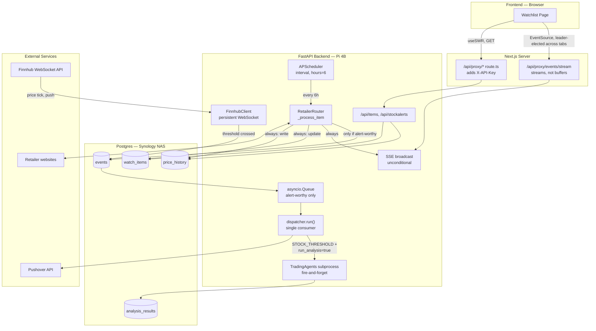

# Architecture

## Overview

Self-hosted notification system running on a Raspberry Pi 4B. Watches product prices and stock tickers, sends alerts via Pushover (iPhone, iPad, Mac, Apple Watch). When a stock threshold is crossed, optionally triggers AI analysis via TradingAgents as a decoupled downstream reaction.

## System Diagram



All lines above are built, live paths — the SSE broadcast/route/EventSource path (`#36`) shipped, closing the gap where the watchlist page polled every 30s regardless of whether anything changed. See `.doc/issues.md` for status.

## Why a Proxy Layer (BFF)

Full design discussion: `.doc/keynotes.md` → "API Proxy Pattern."

Every backend call in the diagram above (`GET /api/proxy/*`) routes through `frontend/src/app/api/proxy/[...path]/route.ts` before reaching FastAPI — this app uses the **BFF (Backend-For-Frontend) / API proxy** pattern. Reason: a browser is fully inspectable (DevTools → Network tab shows every request a page makes, in full), so `API_KEY` can never be attached to a request the *browser itself* sends — it must be attached one hop later, on a server-side request the browser has no visibility into. This is a standard shape, not specific to this project — every major frontend framework ships an equivalent (Next.js Route Handlers, Nuxt server routes, SvelteKit `+server.ts`) specifically to make it easy. It's the reason the `SSEPROXY` node above needs its own streaming-capable handler rather than reusing `PROXY` as-is — same underlying reason (secret must stay server-side), applied to a streamed response instead of a single JSON one.

## Tech Stack

| Layer | Technology | Reason |
|-------|-----------|--------|
| Backend | Python 3.12 + FastAPI | Strong scraping/data ecosystem, async support |
| Frontend | Next.js 14 (App Router) + TypeScript + Tailwind | Dashboard for managing watchlists |
| Database | Postgres (Synology NAS, native DSM package) | NAS over LAN via asyncpg; no Docker on NAS; NAS RAID handles persistence |
| ORM | SQLAlchemy + Alembic | Async-compatible via asyncpg, migration management |
| Scheduler | APScheduler (in-process) | No Redis/Celery needed for personal use |
| Scraping | patchright + httpx + BeautifulSoup4 | patchright for JS-rendered/bot-blocked; httpx+BS4 for SSR, Next.js `__NEXT_DATA__`, Shopify JSON API |
| Stock data | Finnhub WebSocket (primary) + Finnhub REST (fallback/validation/metadata/news) + yfinance (history + trending + market details) | WebSocket for real-time threshold detection; Finnhub REST for degraded mode, ticker validation, company profile, and news; yfinance for dashboard price history charts, trending/popular asset screening, and per-ticker market details (bid/ask/52-week/financials/dividends — none of this is on Finnhub's free tier) |
| Push | Pushover API | Covers iPhone, iPad, Mac, Apple Watch — no Apple Dev account needed |
| Networking | Tailscale | Secure peer-to-peer VPN; Pi reachable from any device off-LAN |
| Deployment | Docker Compose (ARM64) | Containerized, auto-restart, Pi native |
| AI Analysis | TradingAgents (subprocess) | Optional; cloned on Pi, spawned per stock event |

> **Patchright runs headed, not headless — via an Xvfb virtual display (`#15`).** BestBuy (Akamai Bot Manager) and SSENSE (Cloudflare+Riskified) both block headless Chromium specifically — confirmed live that a genuinely headed browser passes both cleanly on the exact same TLS stack, so the block is headless-detection, not network-level. Pi OS Lite has no real display server, so `PatchrightScraper.start_browser()` lazily spawns Xvfb (`:99`) before launching Chromium with `headless=False`. Deliberately decoupled from Chromium's own close/reopen lifecycle (`#47`'s `close_if_idle()`, which cycles far more often than Xvfb ever needs to) — Xvfb holds no session state that goes stale, so it starts once (first real Patchright use after boot) and stops once (`main.py`'s `lifespan` real shutdown), untouched by every Chromium close in between.

**React version — not a deliberate pin, a hard constraint:** `react: ^18` isn't an arbitrary choice, it's what `next: 14.2.35` requires — Next.js 14 doesn't support React 19 at all (that lands in Next.js 15+). No document in this repo previously recorded a reason because there wasn't one to record; it's just what the framework version forces. Bumping to React 19 means a Next.js major upgrade first, not a standalone dependency bump.

> **Known risk — shadcn CLI regenerations can silently reintroduce a React-18-incompatible `Button`.** Surfaced debugging `#10.2`'s row-action dropdown menu (full writeup in `.plan/10.2-wishlist-mutations/challenges.md`): running `npx shadcn@latest add <component>` regenerates shared files as a side effect, not just the component you asked for — `components/ui/button.tsx` got silently rewritten from a `React.forwardRef`-wrapped component to a plain function component with `ref` as an implicit prop, a React 19–only pattern. Under this app's actual React 18, that `ref` never reaches the underlying `@base-ui/react` `Button` — no error, no warning, just a ref that quietly never attaches. Harmless for `Button` on its own, but any Base UI `Trigger`/`Close` rendering `Button` polymorphically (`render={<Button/>}`) as its anchor silently loses its positioning/measurement target — the trigger's own local state (hover, `aria-expanded`) still looks correct, only the actual popup never mounts. No compiler error either, since `@base-ui/react`'s peer range (`^17 || ^18 || ^19`) allows React 18 fine — this is a registry-template assumption, not a real library incompatibility. **After running the shadcn CLI for any new component, grep the diff for `forwardRef` removals on any file that wasn't the component you meant to add** — `git diff --stat` after the CLI run shows every touched file, not just the new one.

## Hardware

| Device | Role |
|--------|------|
| Raspberry Pi 4B 8GB | FastAPI server, scrapers, consumers, Finnhub WebSocket client |
| Synology NAS (DS718+) | Postgres (native DSM package), Plex Media Server, file storage, backups |

## Monorepo Structure

```
youn-server/
├── backend/
│   ├── app/
│   │   ├── api/              # FastAPI routers (items, stocks, poll, health)
│   │   ├── core/             # config, DB session, auth dependency
│   │   ├── models/           # SQLAlchemy ORM models
│   │   ├── services/
│   │   │   ├── scraper/          # BaseScraper, HTTPScraper, PlaywrightScraper, routing
│   │   │   ├── stocks.py         # Finnhub WebSocket client + yfinance fallback
│   │   │   ├── notify.py         # Pushover dispatch
│   │   │   └── trading_agents.py # TradingAgents subprocess wrapper
│   │   ├── consumers/
│   │   │   ├── notify.py         # asyncio.Queue listener → sends Pushover
│   │   │   └── analysis.py       # asyncio.Queue listener → runs TradingAgents if enabled
│   │   └── scheduler/            # APScheduler job definitions + event dispatch
│   ├── alembic/              # DB migrations
│   ├── requirements.txt
│   └── Dockerfile
├── frontend/                 # Next.js 14 App Router
│   ├── src/
│   │   ├── app/              # Pages and route handlers
│   │   └── lib/api.ts        # Typed fetch wrappers (server-side, includes API key)
│   └── package.json
├── .doc/                     # Project documentation (this directory)
├── .env.example
└── docker-compose.yml
```

## Deployment

- **Pi**: Raspberry Pi 4B 8GB, Docker Compose (ARM64), `restart: unless-stopped`; Docker itself boots via its own `systemctl enable docker` (no custom systemd unit — `#13` deliberately skipped building one, redundant given Docker's own boot-enable + compose's restart policy)
- **DB**: Postgres on Synology NAS via native DSM PostgreSQL package; Pi connects over LAN via asyncpg — deliberately *not* routed through Tailscale, stays on the local LAN even for off-LAN client requests
- **Networking**: Tailscale on Pi + all Apple devices, MagicDNS enabled (`#16`) — Pi reachable as `youn-server` both on-LAN and off-LAN, same hostname either way. Frontend served over HTTPS via `tailscale serve` (`443`, auto-provisioned cert) at `https://<tailnet-hostname>`, proxying to the container's plain-HTTP `:3000` — required because the watchlist page's SSE tab-leader election (`sse-leader.ts`) uses the Web Locks API, which only exists in secure contexts. `docker-compose.yml` binds that port to `127.0.0.1` only, closing direct plain-HTTP access on LAN/Tailscale
- **Stock data**: Finnhub WebSocket connection managed by `FinnhubClient`, dynamically subscribes/unsubscribes per active `StockAlert`

## Local Development

Two-file Docker Compose split — one base file both environments can run, one Mac-only patch layered on top:

- **Pi** always runs `docker compose up -d` (no `-f` flags) — reads only `docker-compose.yml`, the real recipe (`backend`, `frontend`, `pihole`), pointed at the real NAS Postgres.
- **Mac local dev** runs `docker compose -f docker-compose.yml -f docker-compose.local.yml up -d --build` — layers a Mac-only patch on top. Compose merges per-service/per-key: `frontend`/`pihole` pass through from the base file untouched; `backend` keeps everything from the base file except its `volumes` key, which the local file overrides to remap the TradingAgents mount from `/opt/tradingagents` to a path under `/Users/...` (Docker Desktop shares `/Users` with containers by default; `/opt` needs manual File Sharing permission otherwise). The local file also adds an entirely new `db` service — a throwaway local Postgres container, deliberately isolated from the NAS DB.
- **Why an isolated local DB, not the NAS directly**: local dev and the Pi hitting the same live database concurrently risks the scheduler double-fire bug (see `challenges.md`). Mac's local `.env` points `DATABASE_URL` at the local `db` container; the NAS connection string is kept commented out alongside it for reference, not deleted.
- **No CI/CD or auto-migration** — building (`--build`) and migrations (`alembic upgrade head`) are manual on both Mac and Pi, every time, independently. `.env` isn't synced automatically between the two either.
- **No git branch workflow** — solo project, every commit goes straight to `main`. Orthogonal to the environment split above (that's a config/database concern, not a code-version one).

## Polling Schedule

| Job | Interval | Notes |
|-----|----------|-------|
| Price scraping | Every 6 hours | Spread requests to avoid rate bans |
| Stock price monitoring | Real-time (WebSocket) | Finnhub pushes on tick; no interval polling |
| Event consumers | asyncio.Queue listeners | Zero-latency delivery; no poll interval |

> **Known limitation — session held across scrape:** `_process_item` holds a single DB session open for the full duration of each scraper call (including Playwright, up to ~30s). Safe for sequential single-server operation with asyncpg connection pooling. Must be refactored to read→close→scrape→open→write before introducing concurrent scraping to this loop (e.g. semaphore-limited parallel jobs) — still true, `poll_prices` remains strictly sequential. A different code path *does* now scrape concurrently, this limitation doesn't cover it: `#10.2`'s bulk `POST /api/items` probes multiple URLs' `scraper_type` via `asyncio.gather` (bounded, `asyncio.Semaphore(3)`) at add-time. It also holds its DB session open for the duration (same pattern as `_process_item`, not a fix for it) — accepted there at this app's request volume (single user, rarely concurrent adds), not because the underlying concern is different. Verified separately before building it that concurrent calls are safe against `PatchrightScraper`'s shared-context design (one persistent browser context, not one process per call). This limitation is specifically about the scheduler's own scrape loop; it isn't a blanket "no concurrent scraping anywhere" rule.

## Event-Driven Flow

Price and stock jobs never call notification or analysis code directly. They write an event row (persistence/audit) and put it on an `asyncio.Queue` (immediate delivery). Consumers are queue listeners, not pollers.

```
Finnhub WebSocket                  APScheduler (scrape job)
    └── price tick                     └── scrape_job()
            └── threshold crossed              └── price ≤ target
                    └── produce(event):
                            db.add(event, status="pending")   ← audit/crash recovery
                            await queue.put(event)            ← immediate delivery
                                    ├── NotifyConsumer (queue listener)
                                    │       → sends Pushover
                                    │       → marks event processed
                                    │
                                    └── AnalysisConsumer (queue listener)
                                            checks stock_alert.run_analysis
                                            if true → spawns TradingAgents subprocess
                                                     → stores result in analysis_results
                                                     → sends follow-up notification
                                            → marks event processed
```

On startup: any `events` rows with `status="pending"` are loaded back into the queue to recover unprocessed events from a crash.

**One shared queue object, multiple producers, one sequential consumer — all inside a single OS process.** `queue = asyncio.Queue()` is created exactly once, in `main.py`'s `lifespan()`, and the same object is then handed out three ways: stashed on `app.state.event_queue` (for route handlers to reach via `request.app.state`, e.g. `poll.py`'s manual trigger and `#41`'s add-time first-scrape dispatch), passed directly as an argument to the scheduled `poll_prices` job, and passed directly to `dispatcher.run(queue)`. Every producer below calls `.put()` independently, with no awareness of the others:

| Producer | Trigger |
|---|---|
| `main.py` (crash recovery) | Startup, reloading `status="pending"` rows |
| `jobs.py`'s `process_item` | Called from `poll_prices` (6h scheduled) **and**, once `#41` lands, from `items.py`'s add-time background scrape — same `.put()` call site, two different triggers |
| `stocks.py`'s `FinnhubClient` | A live WebSocket price tick crossing a `StockAlert` threshold |

All of the above are coroutines/`Task`s running on the **same single event loop, in one Python process** — not separate OS processes (contrast `trading_agents.py`, which genuinely does spawn a subprocess per analysis). "Shared" here means "multiple coroutines hold a reference to the same in-memory object," the same as any Python object passed to several functions — no IPC, no serialization, just ordinary reference semantics.

There is exactly **one** consumer: `dispatcher.run(queue)`, a single `while True: await queue.get()` loop (`consumers/dispatcher.py`) — not two independent listeners despite the two branches drawn above. Each event is dispatched through both phases (`notify.handle()`, then conditionally `analysis.handle()`) sequentially, inside one `_dispatch()` call, before the loop moves on to the next queued item. A burst of events from unrelated producers (a stock tick, a scheduled scrape, an add-time scrape) queues up and is processed strictly in arrival order — a slow `analysis.handle()` run for one event visibly delays delivery of the next one, even though the producers that queued them ran fully concurrently with each other.

### Pushover delivery — the actual pub/sub hop

`NotifyConsumer`'s Pushover call (above) is the one genuine broker-mediated pub/sub hop in this system — this app publishes once, Pushover's own servers fan it out to every device subscribed under your account:

```
NotifyConsumer (this app — the publisher)
   │
   │  POST https://api.pushover.net/1/messages.json
   │  { token: PUSHOVER_API_TOKEN,   ← identifies this app to Pushover
   │    user:  PUSHOVER_USER_KEY,    ← identifies you (all your devices) — a "topic", not a device
   │    title, message, url }
   │
   ▼
Pushover's servers (the broker)
   │  fans out to every device currently subscribed under that user key —
   │  this app never enumerates devices or holds a per-device token
   │
   ├──▶ iPhone        (Pushover app, via APNs)
   ├──▶ iPad          (Pushover app, via APNs)
   ├──▶ Mac           (Pushover app, via APNs)
   └──▶ Apple Watch   (companion push via iPhone)
```

One publish call in, N subscribers out — device count can grow or shrink (new device installs the Pushover app, logs into the same account) without this app's code ever changing. This is why no push-subscription table exists in this schema (`database.md:214`) — Pushover's own account system *is* the subscription registry.

**TradingAgents** is cloned separately on Pi at `/opt/tradingagents`. The backend spawns it as a subprocess, passes the ticker, captures output, and stores structured results. Runs only when `StockAlert.run_analysis = true` — off by default.

## SSE Push Flow

Full design discussion: `.doc/keynotes.md` → "Layered polling — one loop's output can feed another loop's push," and the fan-out/multi-tab-dedup sections following it.

The watchlist frontend no longer polls — it held `/api/proxy/items` on a 30s `refreshInterval` regardless of whether the 6h price-scraper (see Polling Schedule above) had actually produced anything new; that's gone, replaced entirely by this push path.

**Not** a consumer of the `Event`/`asyncio.Queue` system below (`Event-Driven Flow`) — that queue only ever carries alert-worthy event IDs, so it structurally never sees most scrapes. Instead, a separate broadcast fires directly from `_process_item` on every successful scrape, unconditionally, pushing to open SSE connections the moment it happens.

```
Scraper finishes one listing
   │
   ├── always: write PriceHistory + update watch_items (DB)
   │      └── always: broadcast in-memory → SSE → frontend receives push, no polling
   │
   └── only if alert-worthy: write Event row (DB, audit) → asyncio.Queue → dispatcher
          └── → Pushover
```

Two independent branches off the same scrape-completion point — the SSE branch is unconditional (every listing, every cycle), the `Event`/queue/Pushover branch stays exactly as it was before this issue, conditional on crossing a threshold. Neither depends on the other.

Full diagram, including both `process_item` callers (the scheduled `poll_prices` loop and `#41`'s planned add-time background spawn) and the two structurally separate queues involved: `.doc/diagrams/process-item-flow.html`.

**Multi-tab dedup:** the backend's in-memory fan-out (a `set` of connection mailboxes, `backend/app/services/sse.py`) is one real connection per open browser, not per tab — `frontend/src/lib/sse-leader.ts` uses `navigator.locks` to elect one tab as leader per browser, relaying to any other open tabs via `BroadcastChannel`. Mitigates the browser's per-origin connection cap (6 concurrent under HTTP/1.1 — this stack's actual deployment shape, no TLS/HTTP2 in front today).

Shipped as issue `#36` (merged former `#10.1`, `#10.3`). Stock/portfolio live updates via this same mechanism are tracked separately as `#37`, previously blocked by this issue, now unblocked.

## Finnhub WebSocket Flow

```
App starts
    └── FinnhubClient.start()
            ├── connect to wss://ws.finnhub.io?token=FINNHUB_API_KEY
            ├── send subscribe for each active StockAlert ticker
            └── start async listener loop

Finnhub pushes tick: AAPL $189.45
    └── listener receives message
            └── for each trade in data:
                    └── find matching StockAlert(s) for ticker
                            └── check threshold + direction
                                    ├── crossed + alerted_at is None?
                                    │       → write Event to DB
                                    │       → event_queue.put_nowait(event)
                                    │       → set alerted_at = now()
                                    └── recovered above target + alerted_at set?
                                            → clear alerted_at (re-arm)

User adds NVDA alert via POST /api/stockalerts
    └── API route calls FinnhubClient.subscribe("NVDA")
            └── sends {"type": "subscribe", "symbol": "NVDA"} over live connection

User deletes/pauses alert via DELETE or PATCH /api/stockalerts
    └── API route calls FinnhubClient.unsubscribe("NVDA")
            └── sends {"type": "unsubscribe", "symbol": "NVDA"} over live connection

Connection drops
    └── listener catches disconnect
            └── backoff (1s → 2s → 4s → 8s...) → reconnect → re-subscribe all active tickers
```

**Finnhub REST** is used separately for one-off queries — ticker validation on `POST /api/stockalerts` and manual poll trigger. Independent of the WebSocket connection.

**yfinance** is used only for dashboard price history charts (`Ticker.history()`). Never on the real-time path.

> **Design decision — WS subscription is `StockAlert`-only, never extended to `Position`/Holdings (revised 2026-08-10, `#19`).** `#19`'s original design (2026-08-02) had every `Position` call `FinnhubClient.subscribe()` on creation, refcounted against `StockAlert` so a ticker held by both wouldn't get unsubscribed prematurely. Reversed: the websocket is one connection shared across the whole app, capped at ~50 symbols — not scoped per-holding. A portfolio of ordinary size (20-30+ positions) risked exhausting that budget on its own, and unlike an alert (explicit, user-managed, stays small) a holding is rarely removed once bought — the subscribed count would only ratchet upward over time, with no natural release valve, eventually starving the feature the cap actually needs to protect (alerting must work even when nobody has the app open; just displaying a held position's price only needs to be fresh while that page is open). REST `get_price()` + the frontend's existing SWR poll already serves "keep this price reasonably fresh while I'm looking at it," and that exact path is needed regardless for Popular Assets and ad-hoc ticker search (never holdings, never alertable ahead of time) — so un-alerted Holdings positions reuse that same path rather than getting a second, parallel subscription mechanism. Net effect: a ticker is WS-subscribed if and only if it has an active `StockAlert`, independent of which page/tile displays it (Watchlist, Holdings, or otherwise) — see `#37`'s scope note in `.doc/issues.md` for how this bounds that issue's SSE relay too.

> **Correction (2026-08-12) — subscription is real, but there's no live price cache behind it.** This callout previously implied WS-subscribed tickers have a continuously-updated in-memory price available to read. Checked against `stocks.py`: `FinnhubClient`'s per-ticker cache (`_AlertState`) stores only alert config (target price, direction, `alerted_at`) — no price field. The only persisted price, `StockAlert.last_price`, is written solely at the instant a threshold *crosses* (`stocks.py:222`, inside `_fire_event`) — never on a plain tick, never on recovery. So the subscription itself is real and correctly `StockAlert`-only, but "the ticker has live pricing available" does not follow from "the ticker is WS-subscribed" — those are two different claims, and only the first is currently true. A genuine live per-tick price cache is unbuilt, separate future work. See `.doc/issues.md` `#19`'s "Correction" note for the full trace.

## TradingAgents Update & Run Flow

TradingAgents' code, venv, and report output all live on a Docker volume (`/opt/tradingagents`), mounted into the backend container — not in Postgres. The database only ever stores a *pointer* to a report (`AnalysisResult.report_path`), never the code or the report file itself. This separation is what lets updates apply without redeploying: the backend container serves HTTP continuously and never loads TradingAgents' code into its own process — it only spawns a fresh subprocess per analysis, which reads whatever is currently on the volume.

```
Update (user-triggered, POST /api/analysis/tradingagents/update)
────────────────────────────────────────────────────────────
Backend container (already running, serving other requests)
    └── spawn: git pull                    (cwd = /opt/tradingagents)
            └── writes new files directly onto the volume
    └── spawn: pip install -r requirements.txt   (inside .venv, same volume)
    └── return { success, new_commit, output }

    Nothing about the backend's own running process changes.
    No restart, no rebuild, no dropped requests.


Analysis run (independent of whether an update just happened)
────────────────────────────────────────────────────────────
STOCK_THRESHOLD event, run_analysis=true (or manual POST .../analyze)
    └── Backend container spawns a BRAND NEW subprocess:
            /opt/tradingagents/.venv/bin/python run_tradingagents.py <ticker> <date>
    └── Fresh Python interpreter — imports TradingAgents' code from
        the volume AS IT CURRENTLY IS on disk (this is the step that
        picks up any update, whether it ran 5 seconds or 5 months ago)
    └── Calls Anthropic's API, writes a report file to the volume,
        prints one line of JSON to stdout, exits
    └── Backend parses that JSON → writes AnalysisResult row to Postgres
        (status, result, price_target, report_path — a path string,
        not the file)
    └── Sends follow-up Pushover notification
```

The two flows never signal each other directly — the analysis run doesn't know or care whether an update ran recently, it just always reads the volume's current state. That's the entire mechanism: no shared state beyond the filesystem itself, so an update's effect is visible the moment `git pull` finishes.

Same `docker-compose.yml` volume mount works unchanged on any host Docker runs on (dev machine today, Pi once deployed) — only the one-time host setup (clone, build venv) needs repeating per physical machine; the code and mechanics don't change.
