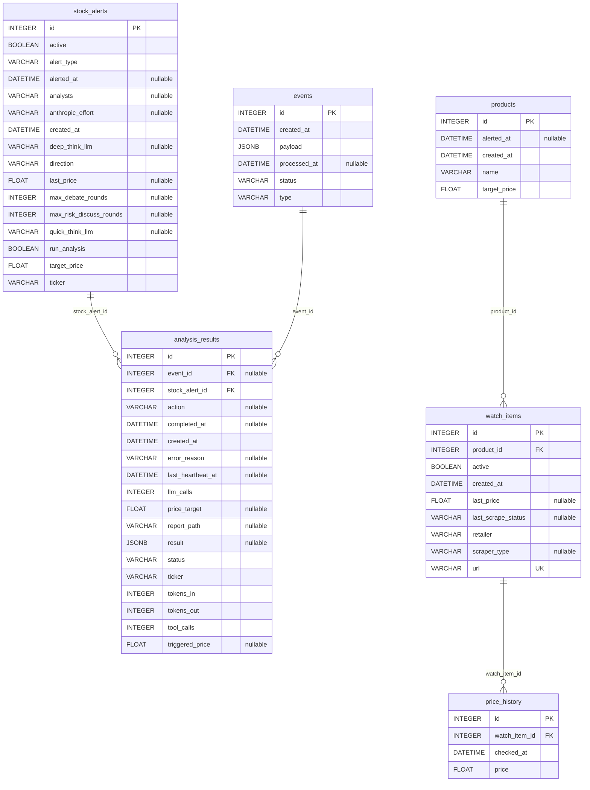

# Database

## Diagram

Generated from the live SQLAlchemy models via [paracelsus](https://github.com/tedivm/paracelsus) — regenerate with `paracelsus inject .doc/database.md app.models.base:Base --import-module app.models` (from `backend/`) whenever a model changes; don't hand-edit between the markers.

<!-- BEGIN_SQLALCHEMY_DOCS -->

<!-- END_SQLALCHEMY_DOCS -->

## Engine

Postgres, installed natively on the Synology NAS via DSM Package Center (PostgreSQL package — no Docker on NAS). Pi connects over the home LAN via `asyncpg`. `DATABASE_URL=postgresql+asyncpg://youn:<password>@<nas-ip>/youn_server` is set in `.env`. Alembic manages schema migrations. Data persistence and backups handled by the NAS natively (RAID, DSM Hyper Backup).

## Models

```python
class Product(Base):
    __tablename__ = "products"

    id: int (PK)
    name: str                    # display name
    target_price: float          # alert fires when cheapest active listing <= this
    alerted_at: datetime | None  # last alert sent; None = not yet alerted
    created_at: datetime

    listings: list["Listing"]    # one-to-many


class Listing(Base):             # one retailer's URL for a Product
    __tablename__ = "watch_items"

    id: int (PK)
    url: str                     # product page URL
    retailer: str                # "amazon_ca" | "bestbuy_ca" | "walmart_ca" | "generic"
    last_price: float | None     # most recent scraped price
    last_scrape_status: str | None  # "ok" | "oos" | "error"; None = never scraped yet
    scraper_type: str | None     # cached scraper method
    active: bool                 # False = paused, skipped during polling — per-listing
    created_at: datetime
    product_id: int (FK → products.id, NOT NULL)

    # name, target_price, alerted_at columns remain on this table post-Migration-A,
    # unused — dropped in a later contract migration (Migration B), not part of #24.

    product: "Product"
    price_history: list["PriceHistory"]


class PriceHistory(Base):        # unchanged — still per-listing
    __tablename__ = "price_history"

    id: int (PK)
    watch_item_id: int (FK → watch_items.id, CASCADE DELETE)
    price: float
    checked_at: datetime         # UTC timestamp of poll cycle


class StockAlert(Base):
    __tablename__ = "stock_alerts"

    id: int (PK)
    ticker: str                  # e.g. "AAPL", "TSLA"
    target_price: float
    direction: str               # "below" | "above"
    last_price: float | None
    alerted_at: datetime | None
    active: bool
    run_analysis: bool           # if True, trigger TradingAgents on threshold cross
    created_at: datetime


class Event(Base):
    __tablename__ = "events"

    id: int (PK)
    type: str                    # "PRICE_DROP" | "STOCK_THRESHOLD"
    payload: JSON                # { item_id?, stock_alert_id?, ticker?, price, url? } — full snapshot, consumers don't re-query
    status: str                  # "pending" | "processed" | "failed"
    created_at: datetime
    processed_at: datetime | None


class AnalysisResult(Base):
    __tablename__ = "analysis_results"

    id: int (PK)
    stock_alert_id: int (FK → stock_alerts.id, CASCADE DELETE)
    event_id: int | None (FK → events.id)
    ticker: str
    triggered_price: float | None
    result: JSON                 # structured TradingAgents output
    status: str                  # "pending" | "running" | "done" | "failed"
    action: str | None           # "Hold" | "Buy" | "Sell" — promoted from result for dashboard display
    price_target: float | None   # from 5_portfolio/decision.md
    report_path: str | None      # filesystem path to saved TradingAgents report
    llm_calls: int                       # live progress counter, updated per heartbeat
    tokens_in: int                       # live progress counter, updated per heartbeat
    tokens_out: int                      # live progress counter, updated per heartbeat
    tool_calls: int                      # live progress counter, updated per heartbeat
    last_heartbeat_at: datetime | None   # timestamp of most recent heartbeat; resets the idle timer
    error_reason: str | None     # "idle_timeout" | "subprocess_error" | "invalid_output" | "max_runtime_exceeded" — set only when status="failed"
    created_at: datetime
    completed_at: datetime | None
```

## Key Design Decisions

**Price history is a byproduct** — every poll cycle writes a `PriceHistory` row regardless of whether an alert fires. No separate history-fetch mechanism needed.

**Alert deduplication via `alerted_at`** — alert skipped if `alerted_at` is set and price hasn't recovered above target. Cleared when price rises back above `target_price`, allowing the alert to re-fire on the next drop.

**Cascade delete on PriceHistory** — deleting a `Listing` removes all its history rows automatically.

**Product/Listing split** — one `Product` (shared name + target price) can have many `Listing` rows (one per retailer). Alerting compares the *cheapest active listing's* price against `Product.target_price`; dedup (`alerted_at`) lives on `Product` so one crossing fires one alert regardless of which retailer triggered it. `Listing` keeps the `watch_items` table name (renaming a live table isn't needed for the split to work) — only the Python class was renamed, from `WatchItem` to `Listing`.

**Two-phase migration for the Product/Listing split** — Migration A (expand): add `products` table + nullable `product_id` on `watch_items`, backfill every existing row as a product-of-one (reusing the same `id`, copying `name`/`target_price`/`alerted_at` into the new `products` row), then set `product_id` NOT NULL + FK. Old `name`/`target_price`/`alerted_at` columns stay on `watch_items`, unused. Migration B (contract, separate/later issue): drops those now-unused columns.

**`status` and `last_checked` are computed, not stored** — neither `Product` nor `Listing` has a status or last-checked column. `last_checked` is `MAX(price_history.checked_at)` per listing (the product-level value shown on the wishlist page is the *stalest* listing, so a silently-broken retailer poll is visible). `status` is computed server-side when building the API response, not duplicated in frontend logic.

**Stock availability is per-listing, not part of `status`** — `Listing.last_scrape_status` (`"ok" | "oos" | "error"`) is the single source of truth for what the last poll found for that retailer. It's surfaced directly per listing (an in-stock/out-of-stock indicator next to each retailer row), not folded into the product-level `status` — being out of stock at one retailer shouldn't hide that the product is still purchasable elsewhere.

**Product-level `status` — 4 states, priority order:**
1. **All** listings inactive → `paused` (nothing being watched; other rules don't apply)
2. Else, among active listings: **any** `last_scrape_status == "error"` → `failed` (a broken scraper is worth surfacing even if another listing is fine)
3. Else: `Product.alerted_at` set → `triggered`
4. Else → `watching` (default)

`oos` is deliberately not a product-level status — a listing being out of stock doesn't change whether the product overall is being watched, triggered, or has a broken scraper.

**No push subscription table** — Pushover uses a static `PUSHOVER_USER_KEY` + `PUSHOVER_APP_TOKEN` stored in `.env`. No per-device token management or registration flow needed. All devices receive notifications automatically via the Pushover apps installed on each device.

**Transactional outbox + asyncio.Queue** — producers write an `Event` row to the DB (persistence/crash recovery) and immediately put it on an in-memory `asyncio.Queue`. Consumers are queue listeners, not pollers — zero-latency delivery. On startup, any `status="pending"` rows are loaded back into the queue to recover unprocessed events from a crash.

**Event payload is a full snapshot** — `payload` stores `{ticker, price, alert_id, url?, ...}` so consumers are stateless and never need to re-query the DB to process an event.

**`run_analysis` is off by default** — TradingAgents costs LLM API tokens and takes minutes to run. The `AnalysisConsumer` checks `stock_alert.run_analysis` before spawning the subprocess; if false, it skips silently.

**`AnalysisResult.status` lifecycle** — `pending` (event claimed, subprocess not yet started) → `running` (subprocess spawned) → `done` (output parsed and stored) → `failed` (subprocess error or timeout).

**Idle-timeout, not flat timeout** — the TradingAgents subprocess logs a `HEARTBEAT` line to stderr on every LLM/tool call start; each heartbeat resets an idle timer (`tradingagents_idle_timeout_seconds`, default 10min) and updates `llm_calls`/`tokens_in`/`tokens_out`/`tool_calls`/`last_heartbeat_at` on the row, so a long-but-alive run isn't killed just for taking a while. A separate hard cap (`tradingagents_hard_cap_seconds`, default 2h) kills the process regardless of heartbeats, setting `error_reason="max_runtime_exceeded"` (distinct from `error_reason="idle_timeout"`).

## Infrastructure

Postgres runs natively on the Synology NAS (DS718+) via the DSM PostgreSQL package. Pi and NAS are on the same home LAN — round-trip latency is sub-millisecond. NAS RAID handles data persistence and DSM Hyper Backup handles backups independently of the Pi.
