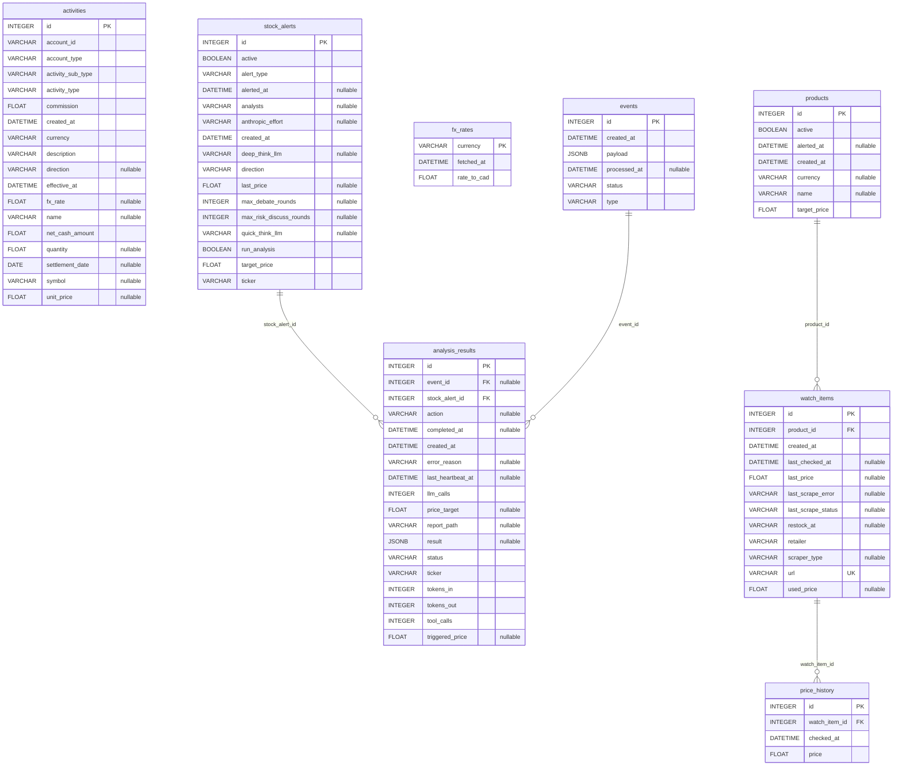

# Database

## Diagram

Generated from the live SQLAlchemy models via [paracelsus](https://github.com/tedivm/paracelsus) — regenerate with `paracelsus inject .doc/database.md app.models.base:Base --import-module app.models` (from `backend/`) whenever a model changes; don't hand-edit between the markers.

<!-- BEGIN_SQLALCHEMY_DOCS -->

<!-- END_SQLALCHEMY_DOCS -->

## Engine

Postgres, installed natively on the Synology NAS via DSM Package Center (PostgreSQL package — no Docker on NAS). Pi connects over the home LAN via `asyncpg`. `DATABASE_URL=postgresql+asyncpg://youn:<password>@<nas-ip>/youn_server` is set in `.env`. Alembic manages schema migrations. Data persistence and backups handled by the NAS natively (RAID, DSM Hyper Backup).

## Models

Grouped by the page that reads them. A table can serve more than one page (`fx_rates`); a few tables have no page of their own (see the last group). The diagram above shows how all of them connect.

| Page | Tables | Served by |
|------|--------|-----------|
| `/` (Dashboard) | none yet | Synology storage status comes from the DSM API (`GET /api/system/storage`), not the database |
| `/portfolio` | `activities`, `fx_rates` | `POST /api/activities/import`, `DELETE /api/activities`; planned `GET /api/positions` and `GET /api/portfolio/summary` (`#19`) |
| `/watchlist` | `products`, `watch_items`, `price_history`, `fx_rates` | `/api/items`, `GET /api/fx-rates` |
| `/market/[ticker]` and backend-only | `stock_alerts`, `analysis_results`, `events` | `/api/stockalerts`, `/api/analysis`, the event queue |

### /dashboard

No tables. The dashboard's storage tile reads the Synology API live. Planned overview tiles (`#22`) will read the tables below, not add their own.

### /portfolio

```python
class Activity(Base):            # one Wealthsimple activity-export row (issue #33) — the ledger of record
    __tablename__ = "activities"
    # index: (account_id, effective_at) — every query is keyed by account_id
    # NO unique constraint — see "Activity ledger" under Key Design Decisions

    id: int (PK)
    effective_at: datetime       # export's effective_date + effective_time, read as America/Toronto (timestamptz)
    settlement_date: date | None # populated on trades only; never used to derive effective_at
    account_id: str              # every import/coverage/derivation query is keyed by it
    account_type: str            # e.g. "TFSA"
    activity_type: str           # "Trade" | "MoneyMovement" | "Interest" | "Dividend" | "Tax"
    activity_sub_type: str       # "BUY" | "EFT" | "E_TRFIN" | "NRT" | "-" ...
    description: str
    direction: str | None        # "LONG" on buys; the sell value is unconfirmed
    symbol: str | None           # Trade + Dividend rows only
    name: str | None
    currency: str                # always "CAD" (the account currency — even USD stock trades); anything else is rejected
    quantity: float | None       # SHARES, and only on Trade rows — the raw CSV column is overloaded (cash amount on every other type)
    unit_price: float | None     # CAD, already FX-converted by Wealthsimple
    fx_rate: float | None        # parsed from "FX Rate: x" in description; present => USD-listed, absent => CAD-native
    commission: float            # stored, never used or validated — self-directed trades are always 0
    net_cash_amount: float       # signed CAD cash movement; a buy's cost basis is -net_cash_amount
    created_at: datetime


class FxRate(Base):              # cached FX rate (issue #45) — also read by /watchlist
    __tablename__ = "fx_rates"

    currency: str (PK)           # "USD" | "KRW"; CAD has no row, its rate is always 1.0
    rate_to_cad: float           # 1 unit of `currency` in CAD (USD row 1.3872 => 1 USD = 1.3872 CAD), inverted at fetch time
    fetched_at: datetime         # refreshed daily by refresh_fx_rates_job; > 24h old is "stale"
```

`#19` adds no tables. Holdings, average cost, cash and prices are all derived in memory from `activities` (and `fx_rates` for the CAD balance); see `.doc/diagrams/portfolio-page-flow-sequence.html`.

### /watchlist

```python
class Product(Base):
    __tablename__ = "products"

    id: int (PK)
    name: str | None             # nullable (#44): filled from the first successful scrape if left blank
    target_price: float          # alert fires when the cheapest active listing <= this
    currency: str | None         # ISO 4217 (#45); inferred from the first scrape unless set manually. "USD" | "CAD" | "KRW" enforced in Pydantic only
    active: bool                 # False = paused, skipped during polling — product-level
    alerted_at: datetime | None  # last alert sent; None = not yet alerted
    created_at: datetime

    listings: list["Listing"]    # one-to-many, cascade delete


class Listing(Base):             # one retailer's URL for a Product
    __tablename__ = "watch_items"

    id: int (PK)
    product_id: int (FK → products.id, CASCADE DELETE, NOT NULL)
    url: str (UNIQUE)            # product page URL
    retailer: str                # "amazon_ca" | "bestbuy_ca" | "walmart_ca" | "generic" | ...
    scraper_type: str | None     # cached scraper method
    last_price: float | None     # most recent scraped price
    last_scrape_status: str | None  # "ok" | "oos" | "error"; None = never scraped yet
    last_scrape_error: str | None   # short reason (#53); set on "error", cleared on the next "ok"/"oos"
    last_checked_at: datetime | None  # when last polled, whatever the outcome — drives "last checked" in the UI
    used_price: float | None     # used offer's price while the new one is sold out (#60); display only, no PriceHistory
    restock_at: str | None       # free-text expected-back date, set only with "oos"; cleared on the next "ok"
    created_at: datetime

    product: "Product"
    price_history: list["PriceHistory"]


class PriceHistory(Base):        # one row per successful poll, per listing
    __tablename__ = "price_history"

    id: int (PK)
    watch_item_id: int (FK → watch_items.id, CASCADE DELETE)
    price: float
    checked_at: datetime         # UTC timestamp of poll cycle
```

`fx_rates` (above) converts a product's price into CAD for display.

### /market/[ticker] and backend-only tables

These have no page of their own among the three. `stock_alerts` and `analysis_results` surface on `/market/[ticker]`; `events` is the backend's outbox and never shown directly.

```python
class StockAlert(Base):
    __tablename__ = "stock_alerts"
    # UNIQUE (ticker, direction, alert_type)

    id: int (PK)
    ticker: str                  # e.g. "AAPL", "TSLA"
    target_price: float
    direction: str               # "below" | "above"
    alert_type: str              # "buy_signal" (default) | "stop_loss" (below) | "take_profit" (above)
    last_price: float | None     # written only when a threshold crosses, never on a plain tick
    alerted_at: datetime | None
    active: bool
    run_analysis: bool           # if True, trigger TradingAgents on threshold cross
    # per-alert TradingAgents overrides — null means "inherit the global .env default"
    deep_think_llm: str | None
    quick_think_llm: str | None
    anthropic_effort: str | None
    max_debate_rounds: int | None
    max_risk_discuss_rounds: int | None
    analysts: str | None         # CSV subset
    created_at: datetime


class Event(Base):               # transactional outbox — see "Transactional outbox" below
    __tablename__ = "events"

    id: int (PK)
    type: str                    # "PRICE_DROP" | "STOCK_THRESHOLD" | "RESTOCK" (DB check constraint)
    payload: JSON                # { item_id?, stock_alert_id?, ticker?, price, url? } — full snapshot, consumers don't re-query
    status: str                  # "pending" | "processed" | "failed"
    created_at: datetime
    processed_at: datetime | None


class AnalysisResult(Base):
    __tablename__ = "analysis_results"

    id: int (PK)
    stock_alert_id: int (FK → stock_alerts.id, CASCADE DELETE)
    event_id: int | None (FK → events.id)
    ticker: str
    triggered_price: float | None
    result: JSON                 # structured TradingAgents output
    status: str                  # "pending" | "running" | "done" | "failed"
    action: str | None           # "Hold" | "Buy" | "Sell" — promoted from result for dashboard display
    price_target: float | None   # from 5_portfolio/decision.md
    report_path: str | None      # filesystem path to saved TradingAgents report
    llm_calls: int                       # live progress counter, updated per heartbeat
    tokens_in: int                       # live progress counter, updated per heartbeat
    tokens_out: int                      # live progress counter, updated per heartbeat
    tool_calls: int                      # live progress counter, updated per heartbeat
    last_heartbeat_at: datetime | None   # timestamp of most recent heartbeat; resets the idle timer
    error_reason: str | None     # "idle_timeout" | "subprocess_error" | "invalid_output" | "max_runtime_exceeded" — set only when status="failed"
    created_at: datetime
    completed_at: datetime | None
```

## Key Design Decisions

**Price history is a byproduct** — every poll cycle writes a `PriceHistory` row regardless of whether an alert fires. No separate history-fetch mechanism needed.

**Alert deduplication via `alerted_at`** — alert skipped if `alerted_at` is set and price hasn't recovered above target. Cleared when price rises back above `target_price`, allowing the alert to re-fire on the next drop.

**Cascade delete on PriceHistory** — deleting a `Listing` removes all its history rows automatically.

**Product/Listing split** — one `Product` (shared name + target price) can have many `Listing` rows (one per retailer). Alerting compares the *cheapest in-stock listing's* price (only listings whose last scrape was `ok` are eligible — a sold-out listing's frozen price must not win the comparison) against `Product.target_price`; dedup (`alerted_at`) lives on `Product` so one crossing fires one alert regardless of which retailer triggered it. `Listing` keeps the `watch_items` table name (renaming a live table isn't needed for the split to work) — only the Python class was renamed, from `WatchItem` to `Listing`.

**Two-phase migration for the Product/Listing split** — Migration A (`0009`, expand): add the `products` table + a nullable `product_id` on `watch_items`, backfill every existing row as a product-of-one (reusing the same `id`, copying `name`/`target_price`/`alerted_at` into the new `products` row), then set `product_id` NOT NULL + FK. The old `name`/`target_price`/`alerted_at` columns stayed on `watch_items`, unused, for a while. Migration B (`0011`, contract) then dropped them. A later migration (`0012`) moved `active` from `Listing` to `Product` — pausing is per-product, not per-listing.

**`status` is computed, `last_checked_at` is stored** — `Product` has no status column. `status` is derived by `services/product_status.py`'s `compute_status` when the API response is built, not duplicated in frontend logic. `Listing.last_checked_at` *is* a column (since `0017`, #53): it records every poll attempt, whatever the outcome. It replaced `MAX(price_history.checked_at)`, which could not see an out-of-stock poll because `PriceHistory` is only written on "ok". The product-level "last checked" shown on the watchlist page is the *stalest* listing's `last_checked_at` (`compute_last_checked`), so a silently-broken retailer poll stays visible.

**Stock availability is per-listing** — `Listing.last_scrape_status` (`"ok" | "oos" | "error"`; `None` = never scraped) is the single source of truth for what the last poll found for that retailer, and is surfaced directly per listing (an in-stock/out-of-stock indicator next to each retailer row). It also feeds the product-level status below, but only through the "all listings out of stock" rule.

**Product-level `status` — 6 states, priority order** (first match wins; `compute_status` in `services/product_status.py`):
1. `Product.active` is false → `paused` (nothing being watched; the other rules don't apply)
2. Any listing never scraped (`last_scrape_status is None`), or any listing mid-scrape right now → `processing`. The mid-scrape check is in memory (`services/scrape_tracking.py`), not a column.
3. Any listing's last scrape was `error` → `failed` (a broken scraper is worth surfacing even if another listing is fine)
4. **Every** listing is `oos` → `out_of_stock` (#54, narrowed from "any" to "all" in #67: one sold-out retailer with another available is still buyable). Checked after `failed`, so a broken scraper outranks a confirmed sold-out reading.
5. `Product.alerted_at` is set → `triggered`
6. Otherwise → `watching` (default)

An `oos` listing among others in stock does not change the product's status — only the "all listings out of stock" case does.

**No push subscription table** — Pushover uses a static `PUSHOVER_USER_KEY` + `PUSHOVER_APP_TOKEN` stored in `.env`. No per-device token management or registration flow needed. All devices receive notifications automatically via the Pushover apps installed on each device.

**Transactional outbox + asyncio.Queue** — producers write an `Event` row to the DB (persistence/crash recovery) and immediately put it on an in-memory `asyncio.Queue`. Consumers are queue listeners, not pollers — zero-latency delivery. On startup, any `status="pending"` rows are loaded back into the queue to recover unprocessed events from a crash.

**Event payload is a full snapshot** — `payload` stores `{ticker, price, alert_id, url?, ...}` so consumers are stateless and never need to re-query the DB to process an event.

**`run_analysis` is off by default** — TradingAgents costs LLM API tokens and takes minutes to run. The `AnalysisConsumer` checks `stock_alert.run_analysis` before spawning the subprocess; if false, it skips silently.

**`AnalysisResult.status` lifecycle** — `pending` (event claimed, subprocess not yet started) → `running` (subprocess spawned) → `done` (output parsed and stored) → `failed` (subprocess error or timeout).

**Idle-timeout, not flat timeout** — the TradingAgents subprocess logs a `HEARTBEAT` line to stderr on every LLM/tool call start; each heartbeat resets an idle timer (`tradingagents_idle_timeout_seconds`, default 10min) and updates `llm_calls`/`tokens_in`/`tokens_out`/`tool_calls`/`last_heartbeat_at` on the row, so a long-but-alive run isn't killed just for taking a while. A separate hard cap (`tradingagents_hard_cap_seconds`, default 2h) kills the process regardless of heartbeats, setting `error_reason="max_runtime_exceeded"` (distinct from `error_reason="idle_timeout"`).

**Activity ledger — positions are derived, never stored** (issue #33) — there is no `Position` table. `Activity` rows are the source of truth; holdings, weighted-average cost and the cash balance are recomputed from them on every read by `services/positions.py`'s `compute_positions`. A buy adds shares and cost (cost = cash actually paid, `-net_cash_amount`); a sell removes shares at the running average, leaving the average cost of what remains unchanged; cash is the sum of `net_cash_amount` over every row (deposits, dividends, interest and tax included). A USD holding's native cost is `unit_price ÷ fx_rate` per trade, weighted-averaged; its CAD cost is the cash paid.

**No unique key on `Activity`, on purpose** — the export has no row id, and two legitimate rows can be identical apart from `description` (real data has same-day $0.01 interest postings). A dedup key built from the other columns collided on exactly those. Overlapping uploads are merged by date range instead (see `.doc/api.md`, "Activities"): rows before (newest stored date − 7 days) are frozen and never touched, and everything from there onward is deleted and re-inserted from the file, per `account_id`, in one transaction.

**FX rates are a cache, one row per currency** (issue #45) — `fx_rates` holds the latest USD and KRW rate to CAD, upserted in place by `refresh_fx_rates_job` (daily). It is never a history table, and CAD has no row (its rate is always 1.0, handled at the read layer). Routes read this table and never call the upstream FX source inline, so a page load is not coupled to that service's uptime. Rows older than 24h, or a missing row, are reported as `stale`.

**Timezone** — the export's times are naive local times. They're read as `America/Toronto` and stored as `timestamptz` (UTC in Postgres); anything shown to a user as a calendar date is converted back to Toronto first, since the same instant can fall on two different days in UTC and local time.

## Infrastructure

Postgres runs natively on the Synology NAS (DS718+) via the DSM PostgreSQL package. Pi and NAS are on the same home LAN — round-trip latency is sub-millisecond. NAS RAID handles data persistence and DSM Hyper Backup handles backups independently of the Pi.
